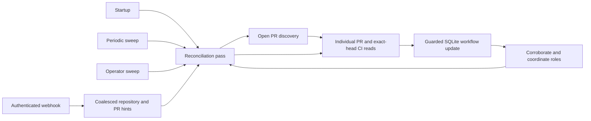

# Switchyard architecture

[ADR-0006](adr/0006-orchestrate-through-native-tools.md) records the accepted architecture. [Plan 003](plans/003-architectural-simplification.md) sequences the replacement. Phase B2 implements repository discovery and shared reconciliation. Phase C2 adds explicit remote native execution and recovery. Phase D coordinates the autonomous PR loop through those paths.

## Accepted direction

A persistent TypeScript controller on a VM uses SQLite for workflow state, execution records and operator decisions. Execution and session management, explicit placement, history and operator operations are reusable by software development workflows that may have no PR. The first workflow applies concrete PR review and revision policy.

- **GitHub observation.** Authenticated webhooks signal that state may have changed. Startup, notifications, periodic sweeps and explicit operator requests share one read-only reconciler. GitHub owns PR state, review content and CI results. Durable initiation and execution records prevent duplicate work. Webhook deliveries are transient.
- **Native execution.** The Codex SDK and Claude Code CLI use a narrow start and resume contract in persistent, trusted environments configured by the operator. Workflows own assignments and result validation. The shared execution subsystem accepts assignment identifiers, prompts and optional response schemas, and reports results and cancellation outcomes independently of workflow policy. Native runtimes retain conversation history. Agents and hosts manage worktrees, Git, permissions, credentials and external identity.
- **PR workflow.** Enabled repositories automatically enroll open, non-draft, same-repository PRs, including those created by people and independent agents. Switchyard dispatches the Reviewer, Adjudicator and Implementer as needed. Agents publish reviews and dispositions, create issues for deferred findings, and implement, validate, commit and push revisions. The controller verifies structured metadata against GitHub. Required CI failures and accepted findings use the same bounded revision path.
- **Handoff and recovery.** Require completed review and passing required CI at the current head, with no unresolved blocking findings. Rejected or deferred findings can satisfy the review gate on unchanged code. A new head invalidates earlier readiness evidence. Reconcile established outcomes, retry known non-execution within limits, and pause on uncertainty. The CLI exposes durable attention requests and operator controls. Merge remains a human decision.
- **Placement.** Named agents specify their provider, invocation context and local or Rex placement. The controller on `switchyard-controller.exe.xyz` reaches the Rex Unix socket on `switchyard-agent.exe.xyz` through SSH. A host unavailable before dispatch leaves a known non-execution that can be retried explicitly. Fixtures and standalone local execution support local development.

## Current implementation

| Area                      | Available behavior                                                                                                                                                                                  |
| ------------------------- | --------------------------------------------------------------------------------------------------------------------------------------------------------------------------------------------------- |
| GitHub observation        | The read-only App lists open PRs in explicitly enabled repositories. Individual PR reads determine lifecycle and eligibility. Startup, webhook, periodic and operator requests use the same worker. |
| Workflow state            | SQLite retains workflow IDs, history and exact-head checks. Durable generations guard overlapping observations. A final PR read confirms eligibility and head before evidence is applied.           |
| Operator visibility       | Status shows process state, pass results, PR heads, GitHub lifecycle and durable holds. A hold prevents active coordination while lifecycle observation can continue.                               |
| Review evidence           | SQLite records exact-head review and finding metadata with GitHub references. The autonomous workflow verifies review and disposition references against GitHub before advancing.                   |
| Explicit native execution | The Codex SDK and Claude Code CLI start or continue sessions locally or through a Rex-launched executor.                                                                                            |

An open listing supplies candidates. A full sweep also reads tracked PRs individually, so an absent entry does not establish closure. A PR-specific hint can go straight to the individual read. A repository hint requests discovery and tracked PR observation. Signals arriving during an active pass can request another pass. Startup and periodic sweeps recover lost signals. The SQLite delivery inbox, claims and replay machinery were removed. [GitHub App setup](github-app.md) · [Operating guide](unattended.md) · [Workflow state](state-model.md)

### Execution and persistence

A session records its optional logical agent name, provider, placement, working directory, optional model and native config directory, and native ID once available. Continuation reuses the stored placement and invocation context. Each execution attempt records its own ID and assignment ID, refers to one session, and records its claim, terminal status and diagnostic when applicable. A session can serve several assignments. Independent sessions can run in the same database, including without any PR records.

Logical agent identity, native session identity, execution identity and external attribution serve different purposes. The execution tables track native session references and individual execution attempts. Concrete workflows own assignment lifecycle. The five execution states support dispatch, known non-execution, completion, failure and uncertainty.

Switchyard commits an execution's intent and claim in one SQLite transaction before invoking an adapter or contacting Rex. A new attempt for the same assignment requires known non-execution of earlier attempts. A running or uncertain execution holds its session. Local runs execute in the standalone CLI process. Their results return to the requesting caller.

For Rex placement, the claim includes a unique attempt key independent of the execution ID. The controller transfers a private request into the attempt directory with `rex cp` and uses `rex run` to start a fresh Node process. The executor claims the directory once, then publishes the Rex block ID, the native session reference when available and the final result through atomic file replacement. The controller reconciles those files with the claim. SQLite stores their correlation and a final digest for repeat reads. Native conversation history stays in the native profile. The agent VM has no Switchyard SQLite state.

A live Rex block is evidence of a running process. Its exit status or a missing acknowledgement can leave the native outcome unknown. After controller restart, explicit recovery and inspection reconcile existing attempts without launching them. An interrupt targets the correlated Rex block, and later evidence may establish process exit and a native outcome separately. [Execution operating guide](agent-sessions.md) · [C1 spike](rex-execution-spike.md)

[Phase A3 verification](native-execution-verification.md) identified an uncaught SDK error that can kill the Node process hosting a Codex turn. The C2 executor confines that crash to the Rex child on the agent VM. The controller's claim remains durable and held when the child exits without a result. [Autonomous role dispatch](autonomous-pr-workflow.md) requires Rex to preserve that process boundary.

### Review evidence

A review row associates a workflow and exact commit with a native GitHub review ID and completion metadata. Finding rows reference native review comments and can record an accept, reject, defer or escalate disposition, a reference to the published reasoning, an issue reference for deferral and a claimed resolving SHA for an accepted finding. Substantive content lives on GitHub. Phase D keeps assignment reservations and normalized claims alongside those references. GitHub evidence is refreshed before handoff and after restart. [Review evidence and inspection](reviews.md)
