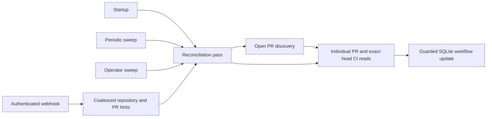

# Switchyard architecture

[ADR-0006](adr/0006-orchestrate-through-native-tools.md) records the accepted architecture. [Plan 003](plans/003-architectural-simplification.md) sequences the replacement. Phase B2 implements repository discovery and shared reconciliation. Standalone native execution was verified in Phase A3.

## Accepted direction

A persistent TypeScript controller on a VM uses SQLite for workflow state, execution records and operator decisions. Execution and session management, explicit placement, history and operator operations are reusable by software development workflows that may have no PR. The first workflow applies concrete PR review and revision policy.

- **GitHub observation.** Authenticated webhooks signal that state may have changed. Startup, notifications, periodic sweeps and explicit operator requests share one read-only reconciler. GitHub owns PR state, review content and CI results. Durable initiation and execution records prevent duplicate work. Webhook deliveries are transient.
- **Native execution.** The Codex SDK and Claude Code CLI use a narrow start and resume contract in persistent, trusted environments configured by the operator. Workflows own assignments and result validation. The shared execution subsystem accepts assignment identifiers, prompts and optional response schemas, and reports results and cancellation outcomes independently of workflow policy. Native runtimes retain conversation history. Agents and hosts manage worktrees, Git, permissions, credentials and external identity.
- **PR workflow.** Enabled repositories automatically enroll open, non-draft, same-repository PRs, including those created by people and independent agents. Switchyard dispatches the Reviewer, Adjudicator and Implementer as needed. Agents publish reviews and dispositions, create issues for deferred findings, and implement, validate, commit and push revisions. The controller verifies structured metadata against GitHub. Required CI failures and accepted findings use the same bounded revision path.
- **Handoff and recovery.** Require completed review and passing required CI at the current head, with no unresolved blocking findings. Rejected or deferred findings can satisfy the review gate on unchanged code. A new head invalidates earlier readiness evidence. Reconcile established outcomes, retry known non-execution within limits, and pause on uncertainty. The CLI exposes durable attention requests and operator controls. Merge remains a human decision.
- **Placement.** Roles run where configured. An unavailable host waits. The Rex spike in Plan 003 precedes the remote transport choice. Named agent configurations will describe how to reach and invoke agents once placement and role needs emerge in Phases C and D. Fixtures and local execution support local development.

## Current implementation

| Area                      | Available behavior                                                                                                                                                                                  |
| ------------------------- | --------------------------------------------------------------------------------------------------------------------------------------------------------------------------------------------------- |
| GitHub observation        | The read-only App lists open PRs in explicitly enabled repositories. Individual PR reads determine lifecycle and eligibility. Startup, webhook, periodic and operator requests use the same worker. |
| Workflow state            | SQLite retains workflow IDs, history and exact-head checks. Durable generations guard overlapping observations. A final PR read confirms eligibility and head before evidence is applied.           |
| Operator visibility       | Status shows process state, pass results, PR heads, GitHub lifecycle and durable holds. A hold prevents active coordination while lifecycle observation can continue.                               |
| Review evidence           | SQLite records exact-head review and finding metadata with GitHub references. Phase D adds corroboration and handoff policy.                                                                        |
| Explicit native execution | The Codex SDK and Claude Code CLI start or continue standalone sessions from a configured local directory.                                                                                          |

An open listing supplies candidates. A full sweep also reads tracked PRs individually, so an absent entry does not establish closure. A PR-specific hint can go straight to the individual read. A repository hint requests discovery and tracked PR observation. Signals arriving during an active pass can request another pass. Startup and periodic sweeps recover lost signals. The SQLite delivery inbox, claims and replay machinery were removed. [GitHub App setup](github-app.md) · [Operating guide](unattended.md) · [Workflow state](state-model.md)

### Local execution and persistence

A session records the provider, local placement, working directory, optional model and native config directory, and the native ID once the runtime reports it. Each execution attempt records its own ID and assignment ID, refers to one session, and records its claim, terminal status and diagnostic when applicable. A session can serve several assignments. Independent sessions can run in the same database, including without any PR records.

Logical agent identity, native session identity, execution identity and external attribution serve different purposes. The execution tables track native session references and individual execution attempts. Concrete workflows own assignment lifecycle. The five execution states support dispatch, known non-execution, completion, failure and uncertainty.

Switchyard commits an execution's intent and claim in one SQLite transaction before invoking an adapter, and commits its terminal status before returning the result. The execution record provides durable deduplication. A new attempt for the same assignment requires known non-execution of earlier attempts. A running or uncertain execution prevents concurrent use of its session. A lost owner becomes uncertain. The runtime retains the conversation, and response content returns to the requesting caller. The [local CLI guide](agent-sessions.md) documents inspection and recovery.

A2 replaced the affected persistence alongside the native adapters because the earlier persistence encoded their worktree, runtime and authorization contracts. The [HTTP worker](distributed-workers.md) depended on these contracts and has been retired. The B2 SQLite baseline retains native sessions and attempts alongside workflow history, observation generations and exact-head evidence.

[Phase A3 verification](native-execution-verification.md) demonstrated both providers through the standalone CLI. The pinned Codex SDK can terminate its host on an early CLI exit. Keep it in the standalone process for local use. The [controller integration gate](plans/003-architectural-simplification.md#phase-a--remove-the-old-fix-pipeline-and-establish-native-execution) applies before long-lived dispatch. Phase C investigates Rex before choosing remote placement and transport. Phase D implements autonomous role dispatch, execution limits, the operator CLI and deployment cutover.

### Review evidence

A review row associates a workflow and exact commit with a native GitHub review ID and completion metadata. Finding rows reference native review comments and can record an accept, reject, defer or escalate disposition, a reference to the published reasoning, an issue reference for deferral and a claimed resolving SHA for an accepted finding. Substantive content lives on GitHub. Phase D will corroborate review results and establish handoff eligibility. [Review evidence and inspection](reviews.md)
