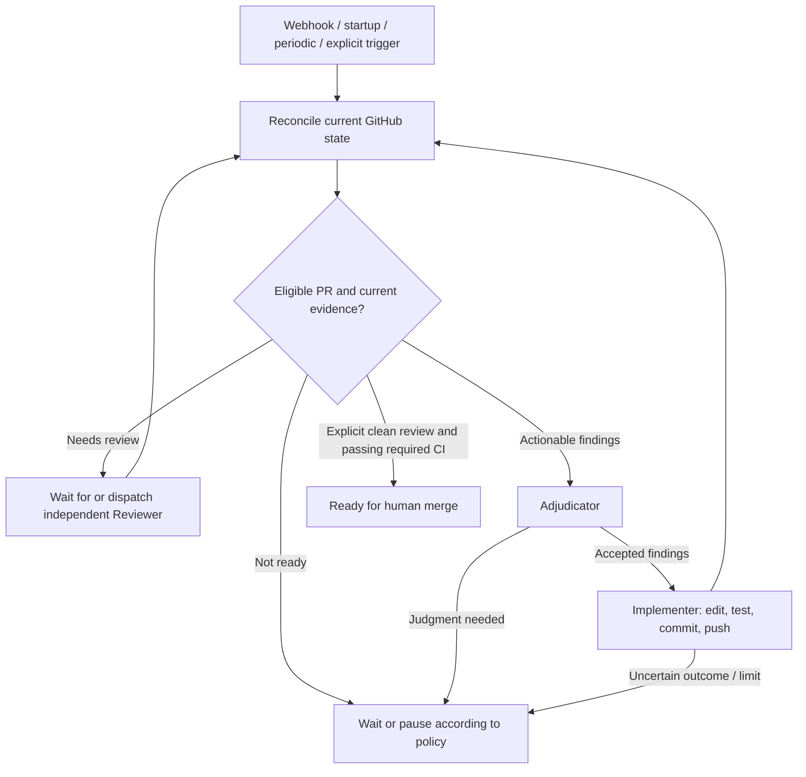

# Plan 003: Architectural simplification

- Status: Proposed for operator review
- Date: 2026-11-25
- Baseline: `3e01e5f` (ADR-0006 merged in PR #22)

## Goal

Bring Switchyard's implementation into alignment with [ADR-0006](../adr/0006-orchestrate-through-native-tools.md). Deliver a small, useful, policy-driven PR review/fix workflow on the VM controller with explicitly placed native agents. A configured repository's eligible PRs enter the workflow automatically; explicit initiation is also available. Agents perform review, adjudication, implementation, validation, commits and push. The controller records decisions and outcomes, observes GitHub, and hands off to the operator on success or uncertainty. Never merge automatically.

This plan replaces the outstanding implementation work in [Plan 002](002-claude-code-authentication.md) and the remaining PR-loop work in [Plan 001](001-pr-review-loop.md). Preserve their historical implementation and investigation records; use this plan for new work. Reassess plan/phase/dependency orchestration after the simpler PR workflow is working.

## Approach and constraints

- Keep TypeScript, Node.js, SQLite, GitHub App authentication, Git worktrees, the official Codex SDK and native Claude Code CLI. Retain useful exact-head review parsing, reconciliation, operation history, and cancellation code.
- Treat GitHub as authoritative for PR, review and CI state; Git for checkout and source state; native providers for sessions; the operator for the execution environment. SQLite owns orchestration state, references and decisions, not source or review text.
- Prefer replacement to adaptation where the old implementation embodies a superseded requirement. Preserve existing useful functions and tests rather than rewrite everything. Do not build a compatibility layer, capability framework, workflow language, external queue, generalized authorization service, or policy engine.
- Each phase should leave a buildable, testable repository. It is acceptable to temporarily disable an obsolete execution path and run observation-only until its replacement is ready. Do not keep two competing production execution paths merely to preserve an intermediate milestone.
- Keep deployed behavior unchanged until the coordinated cutover. Do not run old and new controllers against the same active workflow. Before any destructive schema or deployment change, inspect outstanding work and actual persisted data; stop/drain the old controller, preserve an offline database backup and native profiles/worktrees, and obtain operator agreement to a reset if no operational history needs migration. Otherwise migrate only the needed records. No automatic deletion of checkouts, transcripts or production data.
- Use semantic branches and focused PRs; run formatting, lint, typecheck and tests, and obtain independent review. Replace tests of removed guarantees with tests of the retained requirements. Report measured results rather than target lines of code. Explain any mechanism retained solely because an existing implementation depends on it.

## Target workflow

The diagram is conceptual, not a new workflow engine. Use concrete TypeScript functions and a small persisted state model. Separate an execution result from proof of a workflow result: successful process exit does not prove a review was published or a new commit pushed. Reconciliation observes the authoritative result. A changed head invalidates old review and CI evidence for readiness. Retain the existing limit of three unsuccessful fix cycles for the first workflow unless the operator changes that policy. Never treat an absence of comments as a clean review.

A role assignment identifies a configured worker, provider, model, native profile, repository/PR and task context. Store the native session ID when available, with the checkout/context needed for continuation. Distinct Reviewer, Adjudicator and Implementer sessions can belong to the same PR; no single session binding for the entire workflow. Reuse an implementation session when known and available; do not assume an externally created PR has a discoverable native session. A fresh implementation session with GitHub context is an acceptable proposed fallback under policy.

## Phase A: Retire obsolete controller responsibilities and simplify the native execution foundation

Inspect the actual dependency graph before editing. Start by retiring the controller-owned fix pipeline and its explicit approvals, rather than refactoring it to use a new worktree model. Preserve observation and a minimal explicit agent-turn path for testing. If removing the pipeline exposes coupling, replace the affected state and tests in the same coherent change.

| Existing implementation | Direction |
| --- | --- |
| `src/fix-controller.ts`, `src/fix-git.ts`, `src/fix-store.ts`, `src/fix-command.ts` | Remove controller staging, candidate sealing, commit/push construction, validation runner, allowed paths and per-cycle authorization. Retain only coordination concepts needed by the new workflow. |
| `src/worktree.ts` | Use Git-native checkout creation, location, identity, head and status/diff operations as needed. Remove recursive hashes, ignored-file checkpoints, raw-byte equality and filesystem limits. |
| `src/codex-runtime.ts`, `src/claude-runtime.ts` | Remove internal database reads, transcript hashing, filesystem identity, comprehensive runtime fingerprints and exact-version continuation gates. Keep only necessary supported runtime invocation/context and useful error reporting. |
| `src/agent.ts`, `src/agent-operation.ts`, `src/agent-controller.ts`, `src/agent-store.ts`, `src/local-worker.ts` | Retain a narrow provider boundary and durable execution record. Simplify start/resume, role/session binding and outcome recording. Remove obsolete preconditions and proof requirements. |
| `src/claude-agent.ts`, `src/agent-config.ts` | Use one native Claude launch with ordinary operator-managed settings, explicit subscription or API-key mode, supported session selection and structured output. Remove restricted launcher, key helper, managed-policy inspection, path translation and tool assertions. |

Preserve a single durable record per execution attempt with assignment/operation ID, workflow/role, target head when applicable, placement, native session ID, timestamps, status, bounded diagnostics and outcome references. A conditional claim prevents accidental duplicate starts. Persist intent before dispatch and outcome before advancing. Keep process cancellation/timeouts where needed; do not recreate detailed provider recovery logic.

Use supported native provider APIs. Keep Codex subscription support and its current functional SDK integration; do not introduce a new adapter framework. Remove custom enforcement where it blocks ordinary native use. Provider configuration and permission policy are the operator's responsibility. Use native worktree isolation where appropriate, but not filesystem attestation. Reviewers receive instructions to leave the checkout unchanged; Git-observed unexpected source changes invalidate the review result. This is an outcome check, not a sandbox.

### Claude authentication gate (incorporates Plan 002)

Reuse the documented spike findings. In the actual worker account/context, prepare a persistent private Claude profile and obtain operator sign-in through the official native CLI. Confirm Usage credits are disabled before testing. Use non-bare headless stream JSON with native session continuation. Verify expected authentication mode using supported native status evidence and a successful harmless turn; exclude unintended API credentials from subscription launches. Never fall back from subscription to paid API access. Usage credits and effective native configuration remain operator-managed prerequisites; do not claim programmatic proof of zero overage where unavailable. Retain native API-key support without provisioning an API key or making a metered request in this plan. Test that route offline; any live metered test requires separate operator approval.

Do not pin a particular CLI version as a requirement for resuming an otherwise supported session. Record versions used in live validation and qualify stream/protocol compatibility with tests. Do not remove or bypass native managed settings.

### Acceptance criteria

- Codex and Claude use supported native start and resume interfaces; no direct provider-internal database or transcript reads, content hashes or runtime policy administration.
- A worker can resume a recorded native session after controller restart using the same configured execution context; native resume failure is surfaced without implicit replay. Ordinary supported runtime configuration changes do not automatically invalidate sessions.
- A repository with ignored dependencies/build artifacts larger than the former limits can run normally. Git-native evidence is sufficient for the relevant source-state checks.
- Credentialed local Codex and Claude subscription smoke turns, including continuation and cancellation, are recorded separately from offline tests. Signed-out or mismatched authentication fails visibly. No paid API request.
- Old controller-owned fix/publication/validation paths and their approval and allowed-path requirements are removed or explicitly disabled pending removal within this phase. No production automation is enabled solely by these smoke tests.

## Phase B: One GitHub reconciliation path and metadata-only reviews

Retain the existing GitHub App reader, exact-head reconciliation and supported Codex completion markers in `src/reconcile.ts`, `src/github-api.ts`, `src/github-app.ts` and `src/codex-review.ts`. Consolidate `src/controller.ts`, `src/webhook.ts`, `src/unattended.ts` and `src/main.ts` around one observation/advancement path.

1. Use authenticated webhooks as notifications of potentially changed state. Acknowledge promptly; coalesce pending reconciliation per PR, serialize decisions as necessary, and use the same reconciler for startup discovery, periodic sweeps and manual refresh. Read the current head and relevant evidence from GitHub, not the event payload as an authoritative transition.
2. Remove the durable webhook inbox and delivery replay machinery unless a concrete requirement survives the new trigger model. A missed notification is recoverable through a sweep; duplicate and out-of-order notifications cannot dispatch duplicate work. Retain signature verification and bounded request handling.
3. Discover eligible open PRs in configured repositories. No per-PR configuration list is required for automatic enrollment. Keep explicit start/refresh for development and operator use. Make reconciliation robust to GitHub transient failures and rate limits without unnecessary custom retry machinery.
4. Simplify `src/review-store.ts`, `src/review.ts` and related store/command paths to retain workflow-relevant review metadata and references. Delete `src/review-publications.ts` and controller-side finding/comment publication and synchronization. Preserve exact-head completion recognition and indeterminate handling; retrieve substantive text from GitHub when needed, not from a permanent local copy.
5. Do not invent a new review format until selecting the smallest supported completion/disposition signal in Phase D. Preserve observed automatic Codex review fixtures. A missing, stale, conflicting, edited or removed required evidence item must not silently become a clean verdict.

### Acceptance criteria

- Webhook, startup, periodic and explicit triggers converge through the same implementation. Invalid signatures are rejected. Duplicate/out-of-order notifications and a missed notification followed by a sweep converge without duplicate execution.
- Repository discovery and policy eligibility work without an explicit list of PR numbers; an open PR is reconciled after controller restart.
- The controller can distinguish explicit clean, findings, in-progress and indeterminate reviews on the current head; old heads and absent evidence cannot establish readiness. Required check evidence remains exact-head.
- SQLite retains review/finding identifiers and necessary coordination metadata, not permanent copies of comment text, patches or detailed disposition explanations. The obsolete publication subsystem is gone.

## Phase C: Explicit placement and one execution lifecycle

Keep the existing outbound worker polling over HTTP and SQLite-backed controller unless a simpler demonstrated alternative solves the same requirement. Reuse the shared native execution path from Phase A for both local and remote workers.

- Configure role placement explicitly by worker ID, provider, model and native profile. Keep worker-local repository/profile settings and secrets out of dispatched payloads. A configured worker that is unavailable causes waiting, not reassignment.
- Remove capability matching, scheduling among interchangeable workers, and the remote read-only restriction that existed because the controller owned publication. The remote Implementer can use its native Git credentials and publish its own work. No artifact transfer subsystem.
- Reassess `src/remote-store.ts`, `src/remote-worker.ts`, `src/remote-protocol.ts`, `src/remote-http.ts` and `src/remote-command.ts`. Prefer a single durable assignment and claim, bounded execution, progress/status where useful, and a terminal result that can be acknowledged idempotently. Keep only the fencing/lease or other lifecycle mechanisms actually needed to prevent duplicate starts and reject stale results. Do not add automatic failover, work migration or independent worker attestation.
- On loss of contact, do not blindly reassign or replay potentially executed work. Reconcile outcomes established by GitHub or native session inspection; otherwise hold for operator input. A timed-out claim is not proof the old agent stopped. Document how to inspect and clear a held worker/operation after confirming its state.

### Acceptance criteria

- Explicitly placed roles can run on the Mac mini and exe.dev controller host using their configured profiles. A missing worker waits; another worker does not steal its assignment.
- Separate roles on the same PR retain their own sessions and can execute on different configured hosts. Local and remote execution use the same logical result contract.
- Offline tests cover duplicate assignment/claim/result, stale completion and loss of contact. A credentialed Mac-to-VM smoke run proves native Codex and Claude turns, continuation and a controlled disconnect/ambiguous outcome without duplicate execution. Record what was actually tested.
- No requirement for provider-internal inspection, transfer of a controller-sealed candidate, mandatory capability negotiation or automatic reassignment remains.

## Phase D: Policy-driven PR workflow, deployment and end-to-end validation

Replace the old fix-cycle state machine with a concrete, small PR workflow using the foundations above. Integrate existing automatic Codex review evidence where useful; add the independently configured Reviewer and Adjudicator using the same native execution path, not separate frameworks. Role prompts identify the PR, target head and expected outcome, direct agents to retrieve/publish relevant GitHub content, and distinguish external evidence from instructions. The Implementer runs suitable tests, commits and pushes to the intended PR branch. Switchyard observes the new head, review and CI.

### Proposed initial policy to review with the operator

The following are proposed defaults, not additional accepted product requirements. Resolve them before enabling automatic agent execution:

- Enroll open, non-draft PRs in explicitly enabled repositories. Start with trusted same-repository PR branches and exclude forks until needed. Confirm whether all Dependabot/bot PRs should follow the same policy and whether automatic Codex reviews are the initial Reviewer or an additional configured source.
- Accept explicit, recognized review completion for the current head from the configured reviewer identity/source. Agents publish findings and dispositions to GitHub. Choose a minimal structured completion/disposition convention only if native GitHub review records and the existing Codex marker cannot establish the needed result. Record identities/references, not text.
- The Adjudicator evaluates findings, resolves routine accept/reject decisions with reasons posted to GitHub, and requests input for unresolved judgment, conflicting evidence or scope changes it cannot resolve. Accepted actionable findings initiate implementation without a separate approval. No controller-owned push approval. Retain the existing explicit clean review plus passing required CI handoff rule; an adjudicator dismissing findings is not automatically proof of a clean review. Define how a subsequent explicit review resolves rejected-only findings without pointless fix cycles.
- Wait for required CI and review results. For the first policy, pause on failed required CI if the next action is not already covered by the accepted-finding task; discuss automatic CI-fix workflows later if warranted. Retain the three unsuccessful fix-cycle limit and human merge.
- On a head change unrelated to the current assignment, reconcile the new head and avoid overlapping or stale work. Pause when attribution of an in-flight outcome is uncertain. Define the concrete outcome evidence needed to count a fix cycle and to recognize agent-published reviews.

Use configuration for enabled repositories, role placement and any genuinely needed policy inputs. Do not add a DSL or per-instance delegation service. Support manual workflow initiation, inspection, pause/stop and an explicit operator decision to resume/replace uncertain work. Keep notifications simple (visible status/logs initially; choose a notification integration only when requested).

### Deployment and acceptance criteria

- A persistent VM controller receives authenticated GitHub webhooks and periodically reconciles. One controller owns SQLite. Local development remains possible without a public endpoint.
- On a disposable, explicitly enabled test repository/PR, opening a PR starts the workflow automatically. A recognized review with actionable findings causes adjudication and an agent-owned fix, test, commit and push. The controller records the new head, waits for independent review and CI on that head, and reaches human handoff without per-step approvals. Prove explicit start as well.
- A clean initial review with passing required checks hands off without unnecessary agent calls. A stale or missing review, rejected-only findings, failed/pending CI, closed PR, cycle exhaustion, unavailable worker, duplicate event and uncertain execution are handled by the agreed policy. No automatic merge path.
- Use existing Mac mini/exe.dev infrastructure. Inspect the current infrastructure and GitHub App/webhook setup before proposing changes. Configure required event subscriptions and public HTTPS routing without weakening GitHub protections. Keep credentials and native profiles on their appropriate hosts. Coordinate controller/worker versions and database cutover; keep a rollback procedure and old database backup. Do not enable live auto-fixing across production repositories without operator approval of the policy and rollout.
- Document actual setup, commands, role prompts, configuration, current data model, recovery and test evidence. Update README and operating guides to remove obsolete commands and claims. No obsolete implementation path remains necessary for the new workflow.
- Run repository quality checks and independent review. Record the tested commit, provider versions, deployment topology and live outcomes. Distinguish untested cases from verified behavior.

## Completion and next work

Plan 003 is complete when the end-to-end PR workflow runs under ADR-0006, subscription-authenticated Claude is usable alongside Codex, and the obsolete mechanisms are removed rather than merely bypassed. Keep durable state, deterministic transitions, explicit exact-head evidence and conservative recovery.

Before further roadmap work, review the resulting implementation for remaining unnecessary code and confirm the next concrete use case. The independent adjudicator is part of the PR workflow in this plan. Do not implement the old standalone delegated-authority phase; workflow policy now supplies that authority. Revisit notifications and explicit multi-step plan orchestration only after the PR workflow demonstrates what abstractions, if any, are needed.

The phase boundaries are an implementation proposal. The Implementer may split or combine PRs when dependency inspection shows a smaller coherent change, but must preserve the acceptance criteria and explain the revised sequence. Unresolved policy choices require operator review; they do not prevent removal of obsolete mechanisms and offline development.
